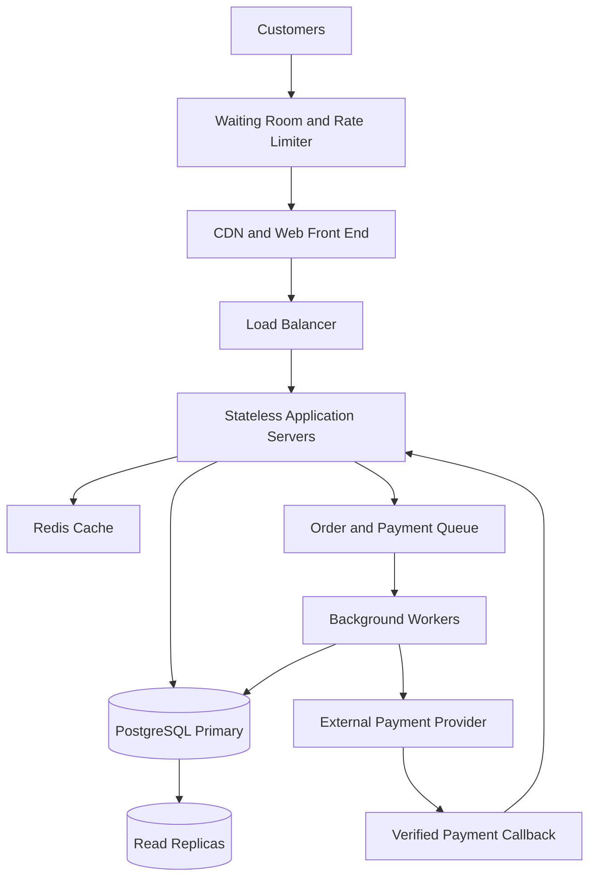

# TicketHub: System Design

## 1. Requirements

### Context

TicketHub is a website where users discover concerts and events, view seat availability, reserve seats, purchase tickets, and access their purchased tickets. The system must support normal daily traffic and sudden demand when a popular concert goes on sale.

### Functional requirements

- Users can register, sign in, and view events.
- Users can search for events and view event details.
- Users can view available seats for a specific event.
- Users can temporarily hold available seats while completing checkout.
- Users can pay for their orders and receive confirmation.
- Users can view their purchased tickets and order history.
- The system prevents two customers from purchasing the same seat.
- Expired holds release seats so other customers can purchase them.

### Non-functional requirements

- **Speed:** Event pages should normally load within 2 seconds, and seat availability and checkout responses should normally complete within 1 second, excluding external payment processing.
- **Correctness:** A seat can have no more than one active reservation or confirmed purchase. Payment and order states must remain consistent.
- **Availability:** Browsing events should remain available during a sale, even if checkout experiences heavy demand.
- **Fairness:** Customers should be processed using a consistent, published queue or waiting-room policy. The system must not allow customers to bypass the queue by repeatedly refreshing or sending requests.
- **Scalability:** The system should handle sudden increases in traffic without losing orders or selling more seats than exist.
- **Security:** Users may access only their own orders and tickets. Payment details must be handled securely by a trusted payment provider.
- **Reliability:** Failed or repeated requests must not create duplicate orders or charges.

## 2. Traffic and Storage Estimates

### Given assumptions

- Registered users: 2,000,000.
- Normal daily visitors: 50,000.
- Pages viewed per visitor: 10.
- Normal daily ticket sales: 5,000.
- Big sale: 200,000 people attempt to buy 20,000 seats in 10 minutes.

### Normal traffic

Daily page views:

50,000 visitors × 10 pages = 500,000 page views/day.

Average page views per second:

500,000 ÷ 86,400 ≈ 5.8 page views/second.

For planning, assume each page view generates one backend request. This gives approximately 5.8 requests/second on average. Actual API traffic will be higher if each page makes multiple requests. If normal peak traffic is five times the daily average, the planning estimate is approximately 29 requests/second.

Normal ticket sales average:

5,000 ÷ 86,400 ≈ 0.058 tickets/second, or about 208 tickets/hour on average.

### Big-sale traffic

Purchase attempts per second:

200,000 people ÷ 600 seconds ≈ 333 purchase attempts/second.

If demand arrives at five times the average rate during short bursts:

333 × 5 ≈ 1,667 purchase attempts/second.

Seat demand compared with supply:

200,000 people ÷ 20,000 seats = 10 people per seat.

The system must handle intense contention because ten potential buyers may compete for each available seat. The number of purchase attempts is not the same as the number of successful sales.

### Comparison

The normal peak estimate is about 29 backend requests/second under the one-request-per-page assumption. The big-sale estimate is approximately 333 purchase attempts/second on average and 1,667 attempts/second during a five-times burst. The burst purchase-attempt rate is about 57 times the estimated normal peak request rate.

These estimates are planning assumptions, not measured production traffic. Load testing must establish the actual capacity needed.

## 3. API Design

The API uses REST conventions and JSON request and response bodies. All order and seat operations require authentication.

| Method and endpoint            | Purpose                                                 | Successful response                   | Important errors                        |
| ------------------------------ | ------------------------------------------------------- | ------------------------------------- | --------------------------------------- |
| GET /events                    | Browse and search events                                | 200 OK with event list                | 400 Bad Request                         |
| GET /events/{eventId}          | View event details                                      | 200 OK with event details             | 404 Not Found                           |
| GET /events/{eventId}/seats    | View seat availability                                  | 200 OK with seat statuses             | 404 Not Found                           |
| POST /events/{eventId}/holds   | Temporarily hold seats                                  | 201 Created with hold ID and expiry   | 409 Conflict if unavailable             |
| POST /orders                   | Create an order from a valid hold and initiate checkout | 201 Created with order ID and status  | 409 Conflict, 422 Unprocessable Content |
| POST /orders/{orderId}/payment | Request payment through the payment provider            | 202 Accepted while payment is pending | 409 Conflict, 502 Bad Gateway           |
| GET /me/tickets                | View the authenticated user's purchased tickets         | 200 OK with ticket list               | 401 Unauthorized                        |

### Example: Hold seats

Request:

```
POST /events/42/holds

{
  "seatIds": ["A10", "A11"]
}
```

Successful response:

```
201 Created

{
  "holdId": "hold-789",
  "status": "ACTIVE",
  "expiresAt": "2026-10-24T18:45:00Z"
}
```

If another customer has already held or purchased either seat, the server returns `409 Conflict`. The server, not the browser, decides whether a seat is available.

### Example: Create an order

Request:

```
POST /orders

{
  "holdId": "hold-789"
}
```

Response:

```
201 Created

{
  "orderId": "order-456",
  "status": "PENDING_PAYMENT"
}
```

The server validates that the hold belongs to the authenticated user and has not expired. Payment callbacks must be verified before an order is marked as paid and tickets are issued.

## 4. Data Model

The design uses a relational database such as PostgreSQL because orders, users, events, and seat ownership require consistent relationships and transactions.

### Tables

**users**

- `id`: primary key.
- `email`: required and unique.
- `created_at`: timestamp.

**events**

- `id`: primary key.
- `title`: required text.
- `venue`: required text.
- `starts_at`: timestamp.
- `sale_starts_at`: timestamp.

**seats**

- `id`: primary key.
- `event_id`: foreign key referencing `events.id`.
- `seat_label`: required text, such as A10.
- `price`: required decimal value.
- `status`: seat status for display and management.

Constraint: `UNIQUE(event_id, seat_label)` ensures a seat label is not duplicated within an event.

**orders**

- `id`: primary key.
- `user_id`: foreign key referencing `users.id`.
- `status`: such as PENDING_PAYMENT, PAID, FAILED, or EXPIRED.
- `idempotency_key`: unique key for safely retrying order creation.
- `created_at`: timestamp.

**seat_holds**

- `id`: primary key.
- `seat_id`: foreign key referencing `seats.id`.
- `user_id`: foreign key referencing `users.id`.
- `hold_expires_at`: timestamp.
- `status`: ACTIVE, CONVERTED, or RELEASED.

Only one active hold may exist for a seat. A partial unique index on `seat_id` for rows with `status = 'ACTIVE'` enforces this rule. Expired holds must be changed to RELEASED before the seat can be held again.

**order_items**

- `id`: primary key.
- `order_id`: foreign key referencing `orders.id`.
- `seat_id`: foreign key referencing `seats.id`.
- `ticket_price`: price recorded at purchase time.

Constraint: `UNIQUE(seat_id)` prevents the same seat from appearing in two orders. This assumes each seat belongs to one event occurrence and is sold only once.

### Relationships

- One user can create many orders.
- One event has many seats.
- One user can create many seat holds.
- One seat can have many historical holds, but only one active hold at a time.
- One order contains one or more order items.
- Each order item references one seat, and a seat can appear in at most one confirmed order.

### Preventing double-booking

The system must not rely only on checking seat availability in the browser. Two customers could see the same available seat before either submits a request.

Instead, the server uses a database transaction:

1. Begin a transaction and lock the requested seat rows using `SELECT ... FOR UPDATE`.
2. Check that each seat is not already sold and has no unexpired active hold.
3. Create the hold and commit the transaction.
4. During checkout, validate the hold and reserve the seat for the order in another transaction.
5. On verified payment success, mark the order as PAID, convert the hold, and commit the confirmed order items.
6. If payment fails or the hold expires, release the hold according to the order and payment state.

The unique constraints are the final safeguard against duplicate ownership. If two requests compete for one seat, the database serializes the conflicting operations; only one can acquire the valid hold. The other receives a conflict response.

Payment processing happens outside the database transaction because external payment services can be slow. A verified payment callback, idempotency keys, and reconciliation handle retries and delayed responses. A paid seat must never be released simply because a callback was delayed.

## 5. High-Level Architecture



### Component explanations

- **Waiting room and rate limiter:** Smooths sudden demand, limits abusive traffic, and gives customers a fair, controlled entry into checkout. Queue admission should follow a consistent policy, with protections against bypassing the queue.
- **CDN and web front end:** Delivers static assets efficiently and reduces load on the application servers.
- **Load balancer:** Distributes requests across healthy application servers and avoids sending all traffic to one server.
- **Stateless application servers:** Handle API requests without storing essential session or order state only in local memory. This allows servers to be added or replaced safely.
- **Redis cache:** Caches event details and other frequently read, relatively stable information. Seat availability must always be validated against authoritative transactional data before a hold or purchase.
- **PostgreSQL primary:** Stores authoritative user, seat, hold, and order data and enforces transactions and uniqueness constraints.
- **Read replicas:** Serve suitable read queries and reduce pressure on the primary database. Stale replica results must never be used to authorize a seat purchase.
- **Order and payment queue:** Buffers background work so a sudden burst does not overwhelm downstream services. Checkout must clearly report pending status rather than promising a ticket before payment is confirmed.
- **Background workers:** Process asynchronous payment and order tasks, retries, expiry processing, and reconciliation.
- **External payment provider and verified callback:** Process payments securely and notify TicketHub of payment outcomes. Callbacks must be authenticated and idempotent.

### How the design survives a big sale

The waiting room limits how quickly customers enter the purchasing flow. The load balancer and stateless servers allow horizontal scaling. Caching reduces repeated event-detail reads, while read replicas handle eligible browsing queries. PostgreSQL remains the authority for seat ownership and uses transactions and unique constraints to prevent overselling. Queues and background workers absorb asynchronous work, and monitoring helps operators identify saturation before it causes widespread failure.

The system should degrade gracefully: event browsing can remain available while new checkout requests are queued or temporarily rate-limited. It must never bypass the database's seat-ownership checks merely to increase throughput.

## 6. Trade-offs

### 1. Strong consistency versus read performance

Using PostgreSQL transactions and unique constraints protects seat ownership, but conflicting purchases may wait for locks and reduce checkout throughput. Caching event details and using read replicas improve browsing performance, but they cannot safely decide whether a seat can be sold.

**Decision:** Prioritize correctness for holds and purchases; use caches and replicas for non-authoritative reads.

### 2. Fairness versus maximum throughput

A waiting room and rate limiter make the sale more orderly and reduce overload, but they introduce waiting time and additional infrastructure. A completely open checkout may appear faster initially, but a surge can overwhelm the service and disadvantage customers with slower connections.

**Decision:** Use a transparent queue policy, rate limits, and controlled admission, while monitoring queue times and system capacity.

### 3. Immediate checkout versus asynchronous processing

Processing all tasks synchronously makes the flow simpler to understand, but slow payment providers can tie up application resources and cause timeouts. Queues and workers improve resilience but introduce pending states, retries, and more complex failure recovery.

**Decision:** Keep seat reservation transactional and move suitable payment and notification work to idempotent background processing.

### 4. Cost versus availability

Multiple application servers, database replicas, and monitoring improve resilience but increase infrastructure and operational costs.

**Decision:** Scale horizontally and add replicas according to measured demand and tested failure scenarios rather than deploying every component at maximum capacity from the start.

## Risks and Open Questions

- Load tests must determine actual API requests per page, queue capacity, database connection limits, and the required server count.
- Payment timeouts and delayed callbacks require reconciliation so customers are not charged twice or issued duplicate tickets.
- Queue rules, hold duration, cancellation policy, and refund handling must be communicated clearly.
- Database backups, recovery procedures, access controls, and alerts must be tested before a major sale.
